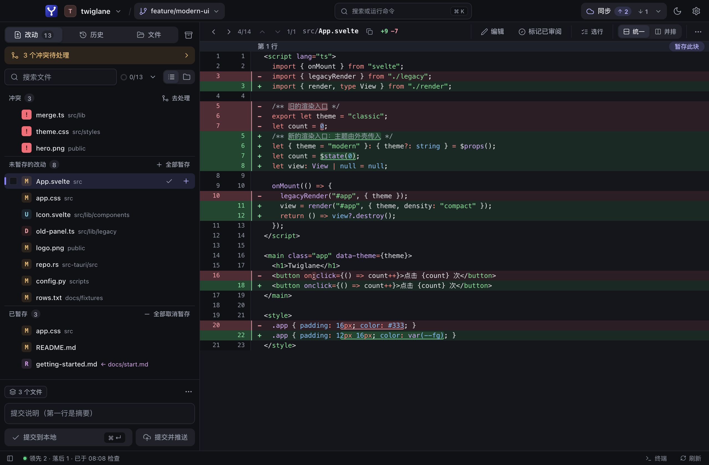
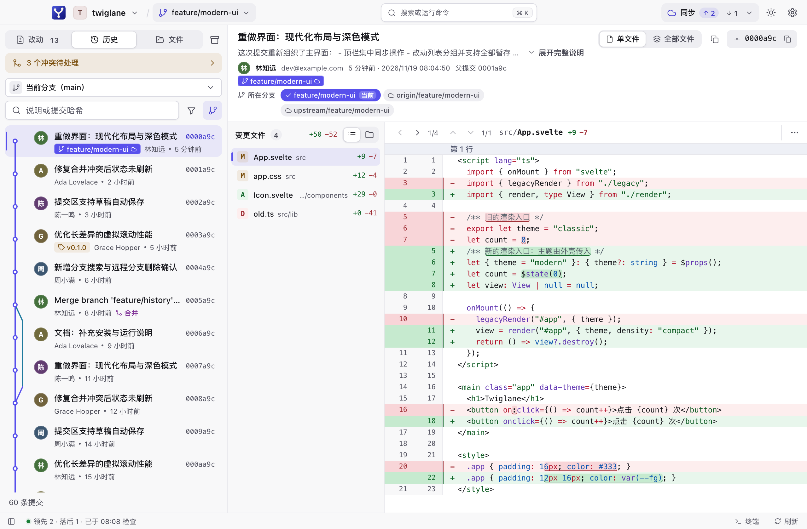
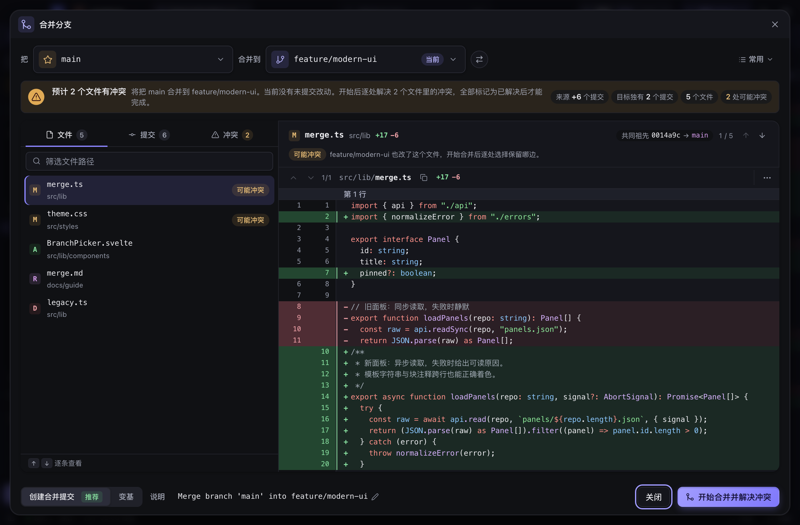
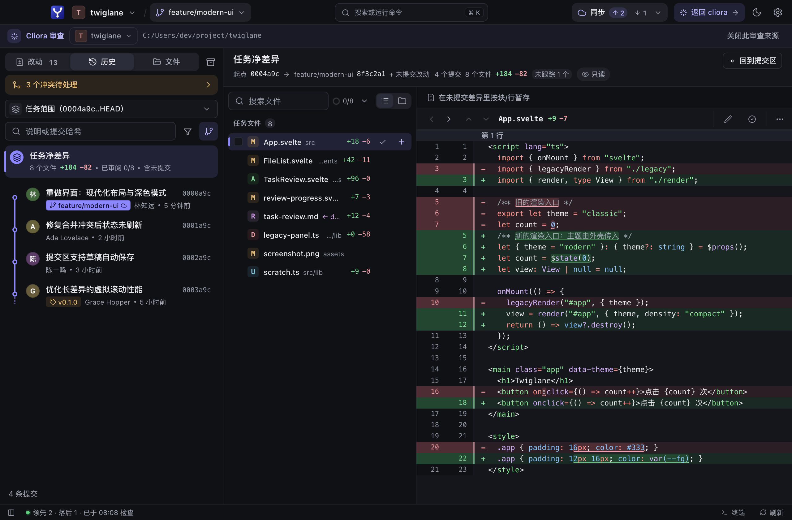

<div align="center">


# Twiglane

**A fast Git desktop client that makes every change clear and every commit safe.**

Stage, commit, merge, resolve conflicts and browse history without memorizing Git commands. Before Twiglane writes anything, it shows what will be affected.

[Download](https://github.com/sakullla/Twiglane/releases/latest) · [中文](README.md) · [Technical reference (Chinese)](docs/reference.md) · Companion app: [Cliora](https://github.com/sakullla/cliora)



</div>

## Why Twiglane

- **See every change** – conflicts, unstaged and staged files are grouped. Diffs are syntax-highlighted with character-level marks, and you can switch between unified and split view. Thousands of files and very long diffs still scroll smoothly.
- **Commit precisely** – stage whole files or individual hunks, or multi-select files for batch actions. The message box warns about long summaries. If "commit and push" fails at the push step, a retry only pushes and never commits twice.
- **Painless conflicts** – compare "current" and "incoming" side by side at each conflict and take either side, keep both, or edit by hand. Trivial conflicts resolve in one click, and the whole flow works from the keyboard.
- **Safe by default** – discarding changes, undoing a commit or deleting a branch first lists the affected files or commits. Pushed commits are never rewritten, and cancelling leaves the repository untouched.
- **Built for AI coding** – with [Cliora](https://github.com/sakullla/cliora), open the full net diff of an AI session (from its starting point to now), mark files as reviewed, then report the commit or merge result back to Cliora.

## Screenshots

| History: graph, commit details and diff | Merge preview: incoming commits, files and likely conflicts |
| --- | --- |
|  |  |



> Screenshots use the built-in mock preview data, not a real repository. The UI is in Chinese.

## Features

- **Changes** – grouped file list, unified/split diffs, hunk staging, batch actions, full-file view, size changes for binary files
- **Commits** – summary length hints, auto-saved drafts, clear in-place messages when identity or hooks fail; amend or undo the latest unpushed commit
- **History** – branch graph; search all history by message, author, hash or path; file history
- **Branches and tags** – quick switcher in the title bar; create, rename and delete branches, with optional slash grouping; push status for tags
- **Merge and conflicts** – preview before merging; per-conflict resolution with three-pane and two-side diff views; continue or abort rebase, cherry-pick and revert
- **Sync** – fetch, pull and push, with ahead/behind counts in the title bar and one-click branch publishing
- **Files** – full tree, repository-wide text search, Markdown reading view and lightweight text editing
- **Terminal** – built-in terminal panel with tabs, split panes and file drag-and-drop; sessions keep running across views
- **Worktrees** – manage git worktrees, with instant search across hundreds of repositories
- **Speed** – `⌘/Ctrl K` command palette, keyboard shortcuts, light/dark/system themes and in-app updates

## Install

Download the package for your system from [Releases](https://github.com/sakullla/Twiglane/releases/latest): `.dmg` for macOS 13+ (Apple silicon), `x64-setup.exe` for Windows 11 x64, `.AppImage` or `.deb` for Linux x64 (only the AppImage supports in-app updates).

- Git must be installed on your system; Twiglane does not bundle it. Git 2.48 or newer is recommended. If Git is missing, the app explains how to install it or lets you pick the `git` executable.
- Windows uses the system WebView2 runtime; the installer downloads it if missing.
- The macOS build is not notarized. On first launch, Control-click the app in Finder and choose Open, or run `xattr -dr com.apple.quarantine /Applications/Twiglane.app`.

Authentication is handled by your system credential helper or SSH agent; Twiglane stores no tokens or private keys.

Twiglane focuses on Git itself. It includes no code-hosting platform features (PRs, issues) and no AI chat. Verified platforms, recovery boundaries and performance methodology are documented in the [technical reference](docs/reference.md).

## Build from source

Requires Node.js 26, Rust, system Git and the [Tauri prerequisites](https://v2.tauri.app/start/prerequisites/).

```bash
npm ci
npm run tauri dev
npm run preview:ui      # mocked UI preview at http://127.0.0.1:1430
npm run check && npm test
cargo test --manifest-path src-tauri/Cargo.toml
npm run tauri build
```

README screenshots come from the `npm run preview:ui` mock data via `node scripts/ui-preview/baseline-shots.mjs --scale 2 --out <dir> --failure-targets none`.

## Contributing

Issues and pull requests are welcome. Commits use `feat:` / `fix:` prefixes; include screenshots for UI changes.
