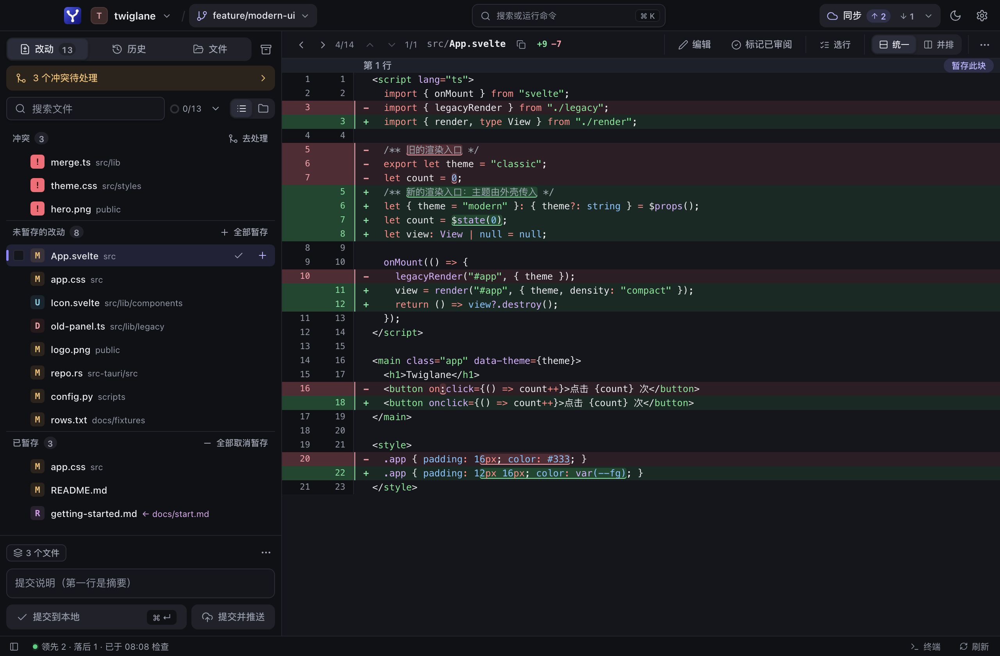
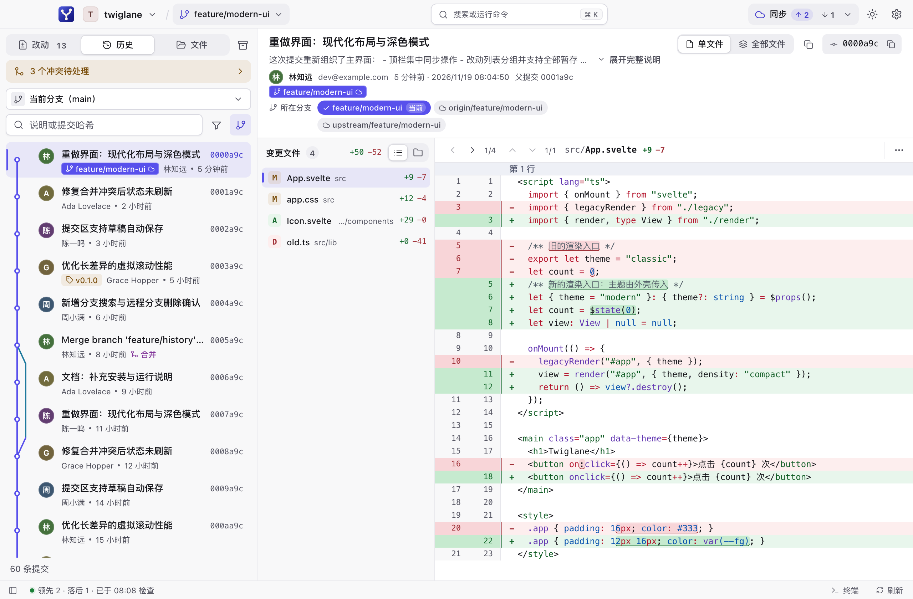
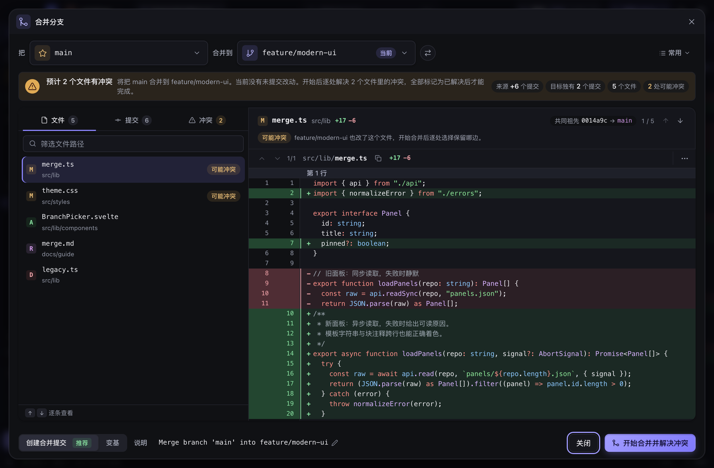
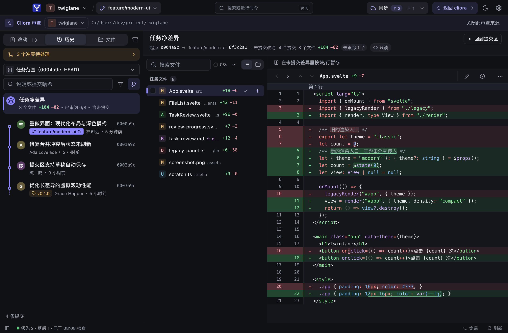

<div align="center">


# Twiglane（枝序）

**让每次改动，都清晰有序。**

轻快的 Git 桌面客户端，看得清改动，也放心提交。

暂存、提交、合并、解决冲突、浏览历史，都在一个界面里完成，不用记 Git 命令；每一步写入前都先告诉你会影响什么。

[下载最新版](https://github.com/sakullla/Twiglane/releases/latest) · [English](README.en.md) · [技术参考](docs/reference.md) · 搭档：[Cliora 栖点](https://github.com/sakullla/cliora)



</div>

## 为什么用 Twiglane

- **改动一目了然**：冲突、未暂存、已暂存分组列出；差异有语法高亮，行内标出具体改了哪几个字符，可在统一和并排之间切换。几千个文件、几万行的差异也能流畅滚动。
- **精细地提交**：可以按文件、按代码块暂存，也可以多选批量处理；提交说明框会提醒摘要长度；“提交并推送”失败时只重试推送，不会重复提交。
- **冲突不再头疼**：逐处并排对照“当前”和“来源”，一键采用某一侧、保留两侧或手动编辑；简单冲突可一键处理，全程可以只用键盘。
- **不怕误操作**：放弃修改、撤销提交、删除分支等危险操作，执行前会列出受影响的文件或提交；已推送的提交不会被改写，取消后仓库保持原样。
- **为 AI 编程而设计**：和 [Cliora](https://github.com/sakullla/cliora) 联动，一键查看 AI 会话从起点到现在的全部改动（任务净差异），逐个文件标记已审阅，提交或合入后把结果带回 Cliora。

## 截图

| 提交历史：分支图、提交详情与差异 | 合并前预览：带入的提交、文件和可能的冲突 |
| --- | --- |
|  |  |



> 截图来自内置的模拟预览数据，不是真实仓库。

## 功能一览

- **改动**：分组文件列表、统一/并排差异、按块暂存、多选批量操作、完整文件视图、二进制文件显示大小变化
- **提交**：摘要长度提示、草稿自动保存、提交身份或钩子失败时就地说明原因；支持修订和撤销最近一次（尚未推送的）提交
- **历史**：分支图、按说明、作者、Hash 或路径搜索全部历史，查看单个文件的历史
- **分支与标签**：标题栏快速切换和搜索分支；新建、重命名、删除分支，按斜杠分组；标签显示是否已推送
- **合并与冲突**：合并前预览；冲突逐处处理，提供三栏和两侧差异视图；支持 rebase、cherry-pick、revert 的继续与中止
- **同步**：获取、拉取、推送，标题栏直接显示待推送和待拉取的数量；没有上游时可一键发布分支
- **文件**：完整目录树、全仓库全文搜索、Markdown 排版阅读，以及轻量的文本编辑
- **终端**：底部内置终端，支持多标签、分屏、拖入文件路径，切换视图时会话不中断
- **工作树**：管理 git worktree，几百个仓库也能即时搜索切换
- **创建 MR / PR**（默认关闭）：在设置里开启后，可从当前分支发起 GitHub / GitLab / Gitea（含自托管）的合并请求；多远程时先选远程，表单里确认目标分支、标题与描述后显式提交
- **效率**：`⌘/Ctrl K` 命令面板，常用操作都有快捷键；支持浅色、深色和跟随系统，并有应用内自动更新

## 支持范围

macOS 13 及以上（Apple 芯片）、Windows 11 x64、Linux x64（AppImage / deb）。哪些系统和架构已经实际安装验证过，见 `docs/verification/report.json`，没有记录的不算已验证。

## 安装与运行

前往 [Releases](https://github.com/sakullla/Twiglane/releases/latest) 下载：macOS 用 `.dmg`，Windows 用 `x64-setup.exe`，Linux 用 `.AppImage` 或 `.deb`（只有 AppImage 支持应用内更新）。

- 需要系统已安装 Git，应用不捆绑 Git，推荐 2.48 或更高版本。找不到 Git 时，界面会告诉你怎么安装，也可以手动指定 `git` 的位置。
- Windows 使用系统自带的 WebView2；缺少时，安装器会联网下载。这部分下载不计入安装包大小。
- macOS 版没有经过 Apple 公证，首次打开时请按住 Control 点按图标并选择“打开”，或运行 `xattr -dr com.apple.quarantine /Applications/Twiglane.app`。

Git 登录凭据交给系统凭据助手或 SSH agent 管理，Twiglane 不保存 Git 令牌和私钥。「创建 MR / PR」用到的平台访问令牌只在开关开启后、由你显式保存，按「平台 + 实例」分别存入系统钥匙串（macOS Keychain / Windows 凭据管理器 / Linux Secret Service），可以在创建对话框里删除，不写进设置文件、日志或界面。

## 创建 MR / PR（默认关闭）

在「设置 → 通用」里打开「创建 MR / PR」后，标题栏分支弹层底部会出现「为当前分支创建 MR / PR…」。关闭时入口不出现，也不会读取平台令牌或发起平台请求。

- **来源与目标**：来源分支永远是当前分支，应用不会自动推送。有上游时按上游远程解析；只有一个远程且能确认同名远程分支时自动使用；多个远程又无法确定时，先让你选远程，选择前不向任何实例发请求。
- **显式提交**：确认目标分支、标题和描述后由你点「创建 MR / PR」；提交期间不能重复创建，应用也不会自动重试。
- **令牌**：缺少令牌或钥匙串不可用时不创建、也不打开网页。令牌按实例保存，创建对话框里可以配置、替换或删除。
- **结果如实展示**：只有平台返回并校验通过的链接才显示为已创建；确认平台不支持该 API 时，打开新建网页（GitLab 只预填来源分支，目标、标题和描述需在网页继续填写）；请求发出后拿不到完整响应时显示「结果未知，请先在平台核对」，不会报告成功；普通失败（认证、权限、限流、参数、冲突等）保留你的输入，由你决定是否再次提交。
- **不改本地仓库**：创建过程不写 Git，不切换分支、不改上游、不推送。

验证范围：以上行为由本机可控制的测试覆盖（模拟 HTTP、钥匙串替身和前端行为测试）。真实 GitHub Enterprise、较旧的 GitLab / Gitea 实例、三个操作系统的系统钥匙串和默认浏览器没有实机记录，因此不能据此认为这些环境已经验证通过；具体见[技术参考](docs/reference.md)。

## 恢复边界

撤销和修订只针对尚未推送的普通提交，并且都不会自动推送；放弃修改前会列出影响范围，取消后不会写入任何内容；中止合并只撤销这一次合并，之前的临时保存仍然保留。已经放弃的未提交内容无法从这里找回。完整规则见[技术参考](docs/reference.md)。

## 性能口径

性能数字是按固定生成的 S/M/L 测试仓库、从真实安装包启动测量的，不是承诺值。测量方法和结果见 `scripts/measure-delivery.mjs` 与 `docs/verification/`。

## 已知限制

- Twiglane 只做 Git 本身：除可选的「创建 MR / PR」外，不包含评审、合并、Issue 等研发平台业务，也没有 AI 聊天功能。
- macOS 版没有 Apple 公证；Windows 和 Linux 的安装运行仍在补充验证。
- 尚缺受控 HTTPS/SSH 远程环境下的认证成功与失败记录。

## 从源码构建

需要 Node.js 26、Rust、系统 Git，以及 [Tauri 的系统依赖](https://v2.tauri.app/start/prerequisites/)。

```bash
npm ci
npm run tauri dev       # 开发运行
npm run preview:ui      # 只预览界面（模拟数据，http://127.0.0.1:1430）
npm run check && npm test
cargo test --manifest-path src-tauri/Cargo.toml
npm run tauri build     # 打包
```

README 截图来自 `npm run preview:ui` 的模拟数据，用 `node scripts/ui-preview/baseline-shots.mjs --full --scale 2 --out <目录> --failure-targets none` 生成后挑选。行为细节、验证方法和发布流程见[技术参考](docs/reference.md)与 [AGENTS.md](AGENTS.md)。

## 参与贡献

欢迎提交 Issue 和 Pull Request。提交信息沿用 `feat:` / `fix:` 前缀；涉及界面的改动请附截图。
