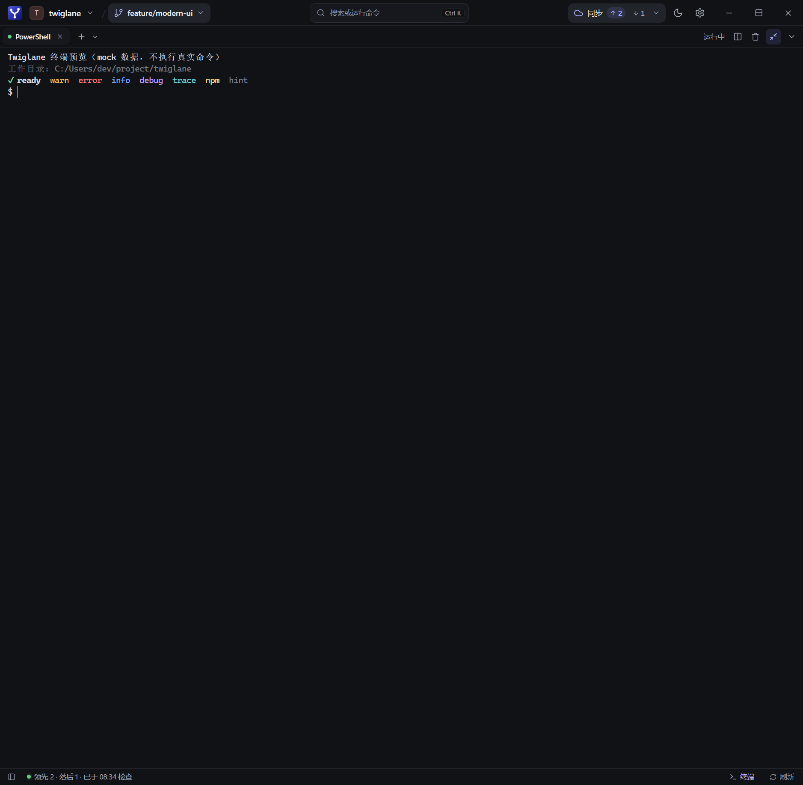

# 终端启动与收起优化验证

环境：Windows，Node.js 26.4.0；浏览器验证使用本机 Chrome 与 mock API。未测量桌面 WebView 中实际 PowerShell 提示符出现的耗时，不宣称启动速度提升百分比。

## 修改依据

- 原来先等待 xterm 与插件加载，再订阅事件、读取回放。现在打开面板时提前订阅，终端组件并行加载模块与读取快照，加载期间的事件按序号去重、补齐。
- 原来收起立即销毁 WebGL，每次展开重新创建。现在短暂隐藏复用渲染器，持续隐藏 1.5 秒后释放；卸载仍立即释放。GPU 初始化安排在首帧绘制之后。
- 原来原生 `terminal_resize` 同步执行。现在使用 Tauri 异步命令，避免 ConPTY 尺寸调整占用窗口消息线程；前端每个会话仅保留一个在途尺寸请求，合并中间尺寸，失败允许重试。

## 实际检查

| 检查 | 结果 |
| --- | --- |
| `npm run check` | 0 errors，0 warnings |
| `npm test -- --maxWorkers=2` | 52 个文件、1348 项通过 |
| `npm test -- tests/terminal.spec.ts` | 46 项通过 |
| `npm run build` | 通过；保留大 chunk 提示 |
| `cargo test --manifest-path src-tauri/Cargo.toml` | 340 项通过，包含 Windows 真实 PTY 用例 |
| `cargo clippy --manifest-path src-tauri/Cargo.toml --all-targets -- -D warnings` | 通过 |
| `node scripts/ui-preview/check-scenarios.mjs --only 终端` | 4/4 通过 |
| `npm run verify:delivery` | 未通过：缺少仓库级 `docs/verification/report.json` |

首轮 UI runner 的两个场景在起始页加载时超时，另两个通过；单独启动预览后重跑四个场景均通过。超时原因未单独归因。

额外通过浏览器初始化脚本关闭预览的 DOM 渲染限制，使用真实 xterm/WebGL 与 mock 会话验证：首次创建 1 个 WebGL 上下文，连续 5 次快速收起/展开后仍为 1 个，同一画布与输入元素保留。隐藏 1750 ms 后画布数量为 0；再次展开后累计上下文数量为 2，输入元素仍为同一个，最大化后文本正常。浏览器有一次 task queue deadline 警告，无控制台错误。此项验证资源复用行为，不代表桌面 GPU 内存或交互延迟测量。

